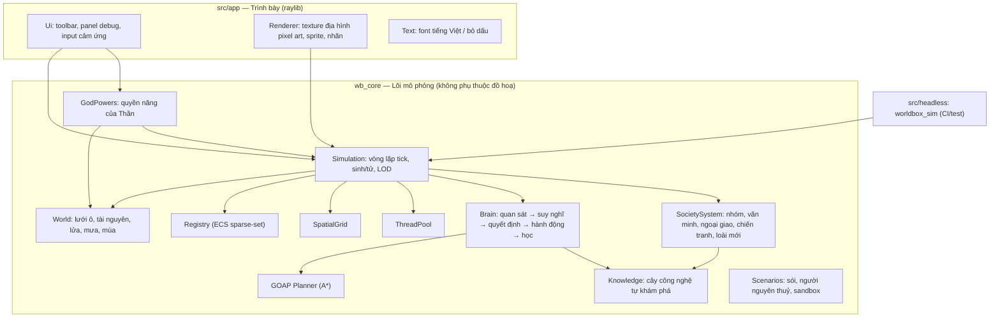
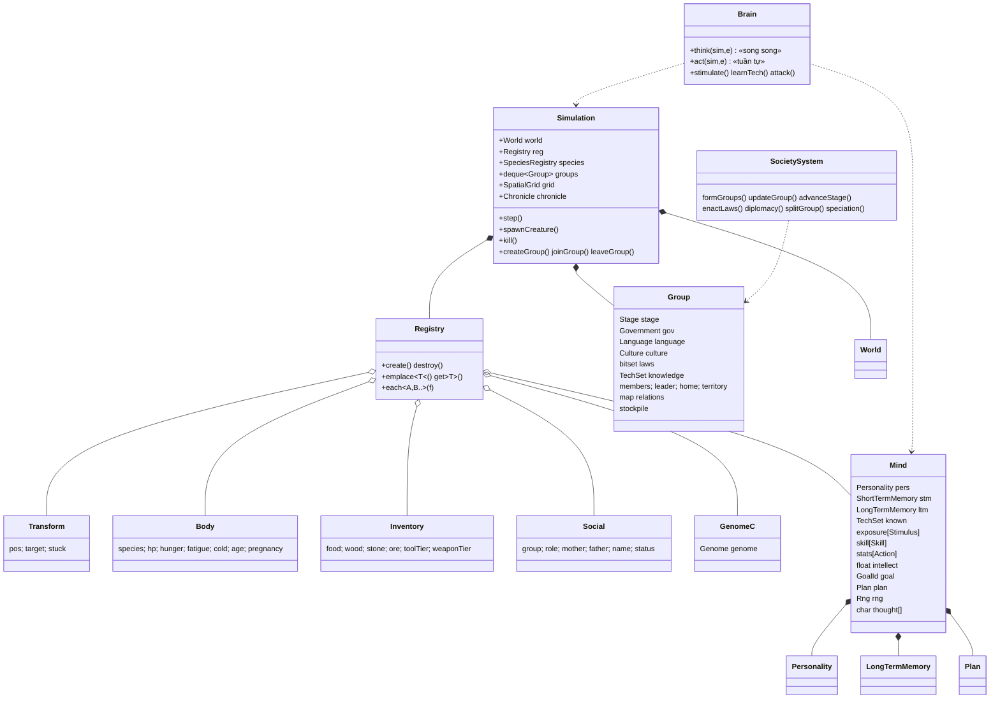

# Kiến trúc WorldBox AI

Tài liệu này giải thích **thiết kế tổng thể**, **lựa chọn công nghệ**, và **từng hệ thống** của game:
thế giới, ECS, AI cá nhân (Utility + GOAP + trí nhớ), tiến hoá sinh học & văn hoá, hình thành
bộ tộc → làng → quốc gia, cùng cách build cho PC và Android (APK).

---

## 1. Lựa chọn công nghệ

| Hạng mục | Lựa chọn | Lý do |
|---|---|---|
| Ngôn ngữ | **C++17** | Hàng nghìn agent AI chạy song song → cần hiệu năng gốc, kiểm soát bộ nhớ. |
| Đồ hoạ / input | **raylib 5.5** | Một API cho Windows/Linux/macOS **và Android** (OpenGL ES 2), nhẹ, dễ học, hỗ trợ cảm ứng đa điểm. |
| Build | **CMake** (+ FetchContent tải raylib) | Cùng một `CMakeLists.txt` dùng cho PC và cho Gradle/NDK. |
| Android | **Gradle + Android NDK + NativeActivity** | Không cần dòng Java nào: `libmain.so` được nạp trực tiếp, raylib cung cấp `android_main()`. |
| Đa luồng | `std::thread` (thread pool tự viết) | Không phụ thuộc thư viện ngoài; chạy tốt trên Android. |
| Kiểm thử | Trình chạy **headless** + `ctest` | Lõi mô phỏng không phụ thuộc đồ hoạ → chạy CI, cân bằng game, benchmark. |

Vì sao không SDL2? SDL2 cũng tốt, nhưng raylib đã gói sẵn: cửa sổ, font TTF, texture, camera 2D,
gesture, Android glue — ít mã nền tảng hơn rất nhiều. Lõi mô phỏng (`wb_core`) hoàn toàn độc lập,
nên đổi sang SDL2 chỉ cần viết lại thư mục `src/app/`.

---

## 2. Sơ đồ hệ thống



Thứ tự một **tick** (`Simulation::step`):

1. `World::update` — cây mọc lại, lửa lan, sét, mưa, hạn hán, mùa, vật phẩm mục rữa.
2. `rebuildGrid` — dựng lại lưới không gian (counting sort, không cấp phát).
3. **THINK song song** — chỉ các agent "đến lượt" (batch theo `nextThink`, LOD theo camera).
4. **ACT tuần tự** — mọi agent thực thi bước hiện tại của kế hoạch; thay đổi thế giới.
5. `metabolism` — đói, mệt, lạnh, già, mang thai → sinh con (lai gen + đột biến).
6. `SocietySystem::update` — hình thành nhóm, thăng cấp văn minh, luật, ngoại giao, tách nhóm, loài mới.
7. `cleanupDead` — để lại **xác** và **công cụ cũ** trên mặt đất (tài liệu học tập cho kẻ khác!).

---

## 3. Sơ đồ lớp (rút gọn)



---

## 4. ECS (Entity Component System)

`src/core/Ecs.h` — kiểu **sparse set** (giống EnTT, tối giản ~150 dòng):

* `Entity` = 32 bit (`version:12 | index:20`) → phát hiện handle cũ sau khi entity chết.
* Mỗi loại component có một `Pool<T>`: mảng **dày** (dữ liệu liền kề, duyệt nhanh, thân thiện cache)
  + mảng **thưa** ánh xạ index → vị trí. Thêm/xoá O(1) (swap-and-pop).
* Component là dữ liệu thuần (`Transform`, `Body`, `Inventory`, `Social`, `GenomeC`, `Mind`).
  Logic nằm trong hệ thống (`Brain`, `Simulation::metabolism`, `SocietySystem`).

> ⚠️ Quy tắc an toàn: **không giữ tham chiếu tới component qua lời gọi có thể thêm component**
> (vd. `spawnCreature`) — mảng dày có thể cấp phát lại. (Lỗi này đã được AddressSanitizer bắt và sửa.)

---

## 5. AI cá nhân (Individual Agent AI)

Mỗi sinh vật — người, sói, gấu, thỏ, quỷ — có một `Mind` riêng. Vòng lặp:

```
 QUAN SÁT ──► SUY NGHĨ ──► QUYẾT ĐỊNH ──► HÀNH ĐỘNG ──► HỌC ──► TIẾN HOÁ
 perceive     Utility AI     GOAP A*        executors    kỹ năng,     gen + văn hoá
 (grid +      chấm điểm      tìm chuỗi      mỗi tick     tỷ lệ thành  truyền cho
  quét ô)     mọi mục tiêu   hành động                   công, phát   thế hệ sau
                                                         minh, dạy
```

### 5.1 Quan sát (`perceive`)
* Tầm nhìn = `5 + trí_tuệ×6 + tò_mò×3` (+3 với thú ăn thịt).
* Truy vấn `SpatialGrid`: phân loại mỗi cá thể thành **Đồng minh / Họ hàng / Kẻ lạ / Kẻ thù / Kẻ săn mồi / Con mồi**,
  tính tổng mức đe doạ, tìm bạn đời gần nhất…
* Quét ô (thưa dần khi tầm nhìn rộng): thức ăn, cây, đá, quặng, **lửa**, **xác chết**, **công cụ cũ**.
* Ghi vào **trí nhớ ngắn hạn** (blackboard) và **dài hạn** (đồ thị sự kiện).
* Phát hiện **kích thích** (thấy lửa, cầm đá, thấy quặng, chứng kiến cái chết, bị nước chặn…) → xếp hàng xử lý phát minh ở pha tuần tự.

### 5.2 Trí nhớ (`Memory.h`)
* **Ngắn hạn**: những gì vừa thấy (≤ 20 percept) + các con trỏ "gần nhất".
* **Dài hạn**: `Fact{loại, vị trí|đối tượng, độ tin cậy, lần củng cố}` — nguồn thức ăn, bãi săn, nguy hiểm,
  nơi có quặng, lửa, nhà… Sức chứa `8 + trí_tuệ×36`; **quên dần** (đường cong lãng quên, trí tuệ cao quên chậm);
  bị **phủ nhận** khi tới nơi mà tài nguyên đã hết.
* **Kinh nghiệm hành động**: tỷ lệ thành công/thất bại từng hành động → nhân vào chi phí GOAP
  (học tăng cường đơn giản: hành động hay hỏng sẽ ít được chọn).

### 5.3 Suy nghĩ — Utility AI (`scoreGoals`)
17 mục tiêu: Ăn, Nghỉ, Chạy trốn, Tự vệ, Sinh sản, Giao tiếp, Khám phá, Lao động cho nhóm, Chế tạo công cụ,
Chế tạo vũ khí, Xây dựng, Trồng trọt, Giữ lãnh thổ, Thờ cúng, Chiến tranh, Giành quyền lực, Thư thả.

Điểm = **nhu cầu** (đường cong đói/mệt/lạnh/đe doạ) × **tính cách** (cởi mở, chăm chỉ, hướng ngoại, hoà đồng,
nhút nhát, tham vọng) × **ngữ cảnh** (vai trò trong nhóm, chiến tranh, luật lệ, nhà ở, dân số…) + quán tính.

### 5.4 Quyết định — GOAP (`Goap.h/.cpp`)
* Trạng thái thế giới theo góc nhìn cá nhân = **32 bit** (`HasFood`, `KnowsTree`, `SeesPrey`, `AtHome`…).
* 34 hành động có `pre`, `effect`, `cost`, yêu cầu (**tech**, **tay khéo**, **thuộc nhóm**, **chế độ ăn**).
* A* tìm chuỗi rẻ nhất (≤ 8 bước). Ví dụ thực tế trong game:
  * Người đói: `Đi tới nguồn thức ăn → Hái lượm → Ăn đồ mang theo`
  * Sói đói: `Lùng sục con mồi → Săn mồi → Ăn đồ mang theo`
  * Thợ xây: `Gom vật liệu xây dựng → Xây công trình`
  * Thợ rèn: `Đào quặng → Chế tạo công cụ` (cần biết *Khai khoáng*, *Luyện kim*)
* Không lập được kế hoạch → thử mục tiêu điểm cao thứ hai → khám phá.

### 5.5 Hành động (`exec`)
Mỗi hành động là một máy trạng thái nhỏ chạy theo tick (đi tới, làm việc N tick, áp kết quả). Di chuyển dùng
steering lách vật cản (thử các góc lệch). Ví dụ đáng chú ý:
* **Săn mồi**: mỗi đồng loại cùng nhóm ở gần **+35%** hiệu quả nếu biết *Săn theo bầy*; trí tuệ cao phối hợp tốt hơn.
  Có luật *Chia sẻ con mồi* → cả bầy được ăn.
* **Giao tiếp / dạy học**: truyền một tri thức + chia sẻ trí nhớ ("chỗ kia có quả"). Có *Ngôn ngữ* → hiệu quả hơn nhiều.
* **Nhặt công cụ cũ**: "học ngược" công nghệ của nền văn minh đã chết.

### 5.6 Học & phát minh (`Knowledge.h`, `Brain::stimulate`)
Không có công nghệ nào được cho sẵn. Mỗi tech cần:
* **ngưỡng trí tuệ**, **tiền đề**, và một **kích thích** phải trải nghiệm đủ số lần.
  Ví dụ: *Dùng lửa* ← thấy đám cháy (sét đánh!); *Công cụ đá* ← cầm nắm đá + gỗ; *Xây cầu* ← bị nước chặn đường;
  *Tôn giáo* ← chứng kiến cái chết/thiên tai; *Luật pháp* ← sống định cư lâu.
* Xác suất phát minh ∝ (trí tuệ − ngưỡng) × tò mò × `learningRate`.
* Một số tech **động vật cũng học được** (săn theo bầy, đánh dấu lãnh thổ, thứ bậc, nơi trú ẩn, ngôn ngữ, tôn giáo, luật).
  Tech cần tay khéo (công cụ, xây nhà…) chỉ mở khi loài tiến hoá ra chi trước cầm nắm.

---

## 6. Tiến hoá

### 6.1 Sinh học (`Genome.h`)
10 gen 0..1: Trí tuệ, Sức mạnh, Tốc độ, Tính bầy đàn, Hung hăng, Tò mò, Sinh sản, Tuổi thọ, Chịu lạnh, Chịu nóng.
Con = lai ghép bố mẹ + đột biến Gauss (`mutationRate`). Không có "hàm fitness" — **chọn lọc tự nhiên** xảy ra vì
cá thể săn giỏi/ thông minh/ chịu lạnh tốt sống lâu và sinh nhiều hơn.

### 6.2 Trí tuệ hiệu dụng
`intellect = gen_trí_tuệ × độ_trưởng_thành + kinh_nghiệm_học_được (≤0.25) + văn_hoá_nhóm (≤0.12)`
→ hiệu ứng **"bánh cóc văn hoá"**: nhóm càng nhiều tri thức, thành viên càng "khôn" hơn tổ tiên cùng bộ gen.

### 6.3 Di truyền văn hoá
* Con thừa hưởng ngẫu nhiên tri thức của bố mẹ + trí nhớ về nguồn thức ăn + nếp chăm chỉ.
* Luật *Người già dạy trẻ* tăng tỉ lệ dạy cho trẻ con. *Chữ viết* → tri thức được lưu ở cấp nhóm, thành viên "đọc" lại được;
  không có chữ viết → tri thức có thể **thất truyền** khi người biết cuối cùng chết.
* **Lan truyền văn hoá** giữa các láng giềng thân thiện.

### 6.4 Hình thành loài mới (`SocietySystem::speciation`)
Nhóm tồn tại ≥ 15 năm, ≥ 6 thế hệ, gen trung bình lệch ≥ 0.30 so với loài gốc → tạo `SpeciesDef` mới
(tên theo ngôn ngữ nhóm, ví dụ *"Sói Krugthai"*). Nếu trí tuệ gen trung bình > 0.5 → **tiến hoá ra chi trước cầm nắm**
(`dexterous = true`): bầy sói đó từ nay có thể chế tạo công cụ và xây nhà!

---

## 7. Nền văn minh: Bầy → Bộ lạc → Làng → Thị trấn → Thành phố → Quốc gia

| Giai đoạn | Điều kiện (loài có tay khéo) | Điều kiện (thú) |
|---|---|---|
| Bầy / Nhóm du mục | ≥ 3 đồng loại tụ lại | như bên trái |
| Bộ lạc / Bộ tộc | ≥ 6, biết *Thứ bậc* và (*Ngôn ngữ* hoặc *Đánh dấu lãnh thổ* + *Săn theo bầy*) | như bên trái |
| Làng / Làng hang ổ | ≥ 10, ≥ 3 nhà/hang, định cư ≥ 1 năm | như bên trái |
| Thị trấn / Lãnh địa | ≥ 22, ≥ 7 nhà, *Trồng trọt* | ≥ 18, *Ngôn ngữ* + *Tôn giáo* |
| Thành phố | ≥ 40, ≥ 12 nhà, *Xây đá* | ≥ 30, *Luật pháp* |
| **Quốc gia** | ≥ 30, *Luật pháp* + *Chữ viết* + Toà thị chính, từ Thị trấn | ≥ 20, *Luật pháp*, từ Làng |

Khi thành lập quốc gia: tên quốc gia, **quốc kỳ** (2 màu + biểu tượng), **thể chế** (Quân chủ, Cộng hoà, Thần quyền,
Quân phiệt… suy ra từ văn hoá), quốc đạo, ngôn ngữ. Dân số giảm mạnh → **suy tàn** (tụt cấp).

Các cơ chế nổi lên (emergent):
* **Văn hoá** = trung bình động tính cách thành viên (thượng võ, tín ngưỡng, ham hiểu biết, cộng đồng, bài ngoại, truyền thống).
* **Luật lệ** ban hành theo tri thức + văn hoá: *Đầu đàn ăn trước, Chia sẻ con mồi, Bảo vệ lãnh thổ, Cấm giết đồng loại,
  Người già dạy trẻ, Nghĩa vụ quân sự, Đóng thuế, Nghĩa vụ thờ cúng, Mở cửa biên giới, Bài ngoại*.
* **Vai trò**: thủ lĩnh, trưởng lão, lính, thợ xây, nông dân, tư tế, thợ săn, hái lượm, trẻ con — giao theo nhu cầu nhóm + tính cách.
* **Kiến trúc**: lều → nhà gỗ → nhà đá → kho lương, xưởng, lò rèn, đền thờ, toà thị chính, tường thành, tháp, lâu đài, cầu;
  màu mái theo màu nhóm. Thú xây *hang ổ* và *dấu lãnh thổ*.
* **Ngôn ngữ thủ tục**: mỗi nhóm có bộ âm vị riêng; nhóm tách ra → ngôn ngữ **trôi dạt** (cùng ngữ hệ nghe na ná nhau).
* **Tôn giáo**: lần đầu có tín ngưỡng → sinh ra một vị thần, lĩnh vực theo trải nghiệm (lửa, mưa giông, mặt trăng cho sói…).
* **Ngoại giao**: thiện cảm ± theo họ hàng, tranh chấp biên giới, giết chóc; tuyên chiến, hành quân, phá công trình,
  nghị hoà khi mỏi mệt, **chinh phục & sáp nhập** (kẻ thắng học tri thức của kẻ thua).
* **Tách nhóm**: quá đông / bất đồng → kẻ tham vọng nhất dẫn 40% đi lập nhóm mới.

---

## 8. Ví dụ cụ thể (kịch bản có sẵn)

### 8.1 Đàn sói → Bộ tộc sói có lãnh thổ & luật lệ (`--scenario wolves`)
1. 10 con sói (trí tuệ gen ~0.26) giữa đồng cỏ đầy hươu/thỏ, một bầy đối thủ ở xa.
2. Chúng tụ thành **Bầy**. Săn cùng nhau → kích thích *GroupHunt* → con thông minh nhất phát minh **Săn theo bầy**,
   rồi **dạy** lại cho đồng loại qua hành động *Giao tiếp*.
3. Săn theo bầy hiệu quả hơn → sói thông minh ăn no, sinh nhiều → gen trí tuệ của quần thể **tăng dần**.
4. Sống đông → **Thứ bậc xã hội** (con đầu đàn mạnh nhất). Chạm trán bầy khác → **Đánh dấu lãnh thổ**.
5. Đủ điều kiện → **Bộ tộc sói**: lãnh thổ riêng (viền màu trên bản đồ), luật *Đầu đàn ăn trước*, *Chia sẻ con mồi*,
   *Bảo vệ lãnh thổ* — sói đi tuần đánh dấu biên giới, tấn công kẻ xâm nhập.
6. Về lâu dài: *Nơi trú ẩn* → **làng hang ổ**, *Ngôn ngữ*, *Tôn giáo* (thờ "Thần Mặt Trăng"), có thể tiến hoá
   thành **loài sói mới** và lập **Vương quốc Sói**.

Kết quả chạy thật (`worldbox_sim --scenario wolves --seed 3`): bộ tộc sói đầu tiên hình thành ở **năm 5**,
làng hang ổ ở năm 13, bầy đầu tiên thờ thần ("Thần Cái Chết") ở năm 20, và từ năm 25 bắt đầu tách ra
các loài sói mới (*"Sói Raimrem"*, *"Sói Vêgtô"*…).

### 8.2 Người nguyên thuỷ → Quốc gia (`--scenario humans`)
1. 14 người trắng tay cạnh rừng và đồi đá.
2. Nghịch đá + gỗ → **Công cụ đá**; sét đánh cháy rừng → **Dùng lửa** (nấu chín: no lâu hơn, ấm hơn).
3. Lạnh/mưa → **Nơi trú ẩn** → lều; đốn gỗ nhiều → **Chế biến gỗ** → nhà gỗ → **Làng**.
4. Ăn cây trái lâu → **Trồng trọt** → ruộng, kho lương → **Thị trấn**.
5. Thấy quặng → **Khai khoáng**; lửa + quặng → **Luyện kim** → vũ khí kim loại.
6. Ngôn ngữ + trồng trọt → **Chữ viết**; định cư lâu → **Luật pháp** → toà thị chính → **QUỐC GIA**.

Kết quả chạy thật (`worldbox_sim --scenario humans --seed 8`): làng đầu tiên ở năm 18, thị trấn ở năm 39,
**quốc gia đầu tiên ở năm 42** (*"Thánh quốc Rainai"* — thể chế Thần quyền, quốc đạo thờ thần Mưa Giông).
Mỗi seed cho một lịch sử khác nhau (seed 5: làng ở năm 15, thị trấn ở năm 48).

---

## 9. Hiệu năng

| Kỹ thuật | Ở đâu |
|---|---|
| ECS dữ liệu liền kề | `core/Ecs.h` |
| Lưới không gian (CSR, không cấp phát) | `core/SpatialGrid.h` |
| **Batch update**: agent chỉ suy nghĩ mỗi `thinkInterval` tick, lệch pha nhau | `Simulation::step` |
| **LOD**: ngoài màn hình 12 tick/lần, sinh vật bản năng +3, thủ lĩnh 4 | `Simulation::metabolism` |
| **Song song hoá** pha suy nghĩ (đọc-only thế giới, ghi-only bộ não riêng) | `core/ThreadPool.h` |
| Quét ô thưa theo bàn cờ xen kẽ giữa các nhịp | `perceive` |
| Bộ đệm `thread_local` cho A* | `planActions` |
| Texture địa hình chỉ vẽ lại ô bẩn, upload thưa | `app/Renderer.cpp` |
| Trần dân số mềm theo loài + mật độ (carrying capacity) | `scoreGoals` |

Đo thực tế (4 lõi, headless): ~1000 tick/s với ~3000 agent. Ở tốc độ 1x game cần 20 tick/s.

---

## 10. Build

### PC
```bash
sudo apt install libx11-dev libxrandr-dev libxinerama-dev libxcursor-dev libxi-dev libgl1-mesa-dev  # Linux
cmake -S . -B build -DCMAKE_BUILD_TYPE=Release
cmake --build build -j
./build/worldbox                      # game
./build/worldbox_sim --scenario wolves --years 40   # headless
ctest --test-dir build                # kiểm thử kịch bản
```
Windows: mở thư mục bằng Visual Studio (CMake) hoặc `cmake -G "Visual Studio 17 2022"`.

### Android (APK)
Yêu cầu: Android SDK (platform 34), **NDK** (r25+), CMake 3.22.1 của SDK, JDK 17, Gradle 8.7+.
```bash
cd android
gradle assembleRelease -PndkVersion=<phiên_bản_NDK_đã_cài>
# → android/app/build/outputs/apk/release/app-release.apk
adb install -r app/build/outputs/apk/release/app-release.apk
```
* Không có mã Java: `NativeActivity` nạp `libmain.so` (`android.app.lib_name = main`).
* Gradle gọi chính `CMakeLists.txt` gốc; khi `ANDROID` được đặt, CMake build `libmain.so` thay vì file thực thi
  và raylib dùng `PLATFORM=Android` (OpenGL ES 2 + native_app_glue).
* APK release được ký bằng khoá debug để cài thử ngay; thay `signingConfig` bằng keystore riêng khi phát hành.
* **CI**: `.github/workflows/build.yml` tự build APK trên mỗi lần push và đính kèm vào mục *Artifacts*.

### Điều khiển
| Thao tác | Cảm ứng | PC |
|---|---|---|
| Di chuyển bản đồ | kéo 1 ngón (chế độ Quan sát) / kéo 2 ngón | chuột phải/giữa, WASD |
| Phóng to/thu nhỏ | chụm 2 ngón | lăn chuột |
| Dùng quyền năng | chạm / giữ & kéo (công cụ vẽ) | chuột trái |
| Xem suy nghĩ sinh vật | chạm vào sinh vật | click |
| Xem nền văn minh | chạm vào lãnh thổ | click |
| Tạm dừng / tốc độ | nút ‖ 1x 4x 15x 50x | Space, phím 1–5 |
| Debug suy nghĩ toàn màn hình | nút "Suy nghĩ" | F1 |
| Biên niên sử | nút "Biên niên" | Tab |

---

## 11. Mở rộng

* **Thêm loài**: thêm một khối trong `SpeciesRegistry::initDefaults` (gen, chế độ ăn, kích thước, màu).
* **Thêm công nghệ**: thêm vào `enum Tech` + một dòng trong bảng `kTechs` (ngưỡng trí tuệ, kích thích, tiền đề).
* **Thêm hành động AI**: thêm `ActionId`, một dòng trong `kActions` (pre/effect/cost/yêu cầu) và một `case` trong `exec`.
  GOAP tự động kết hợp hành động mới vào kế hoạch.
* **Thêm mục tiêu**: thêm `GoalId`, trạng thái mong muốn trong `kGoalStates`, công thức điểm trong `scoreGoals`.
* **Thêm công trình**: `enum Building` + `buildingInfo` + sprite 4×4 trong `Renderer.cpp` + quy tắc trong `pickBuilding`.
