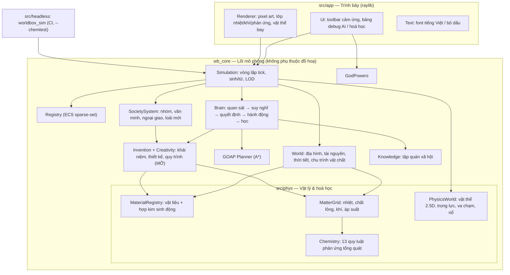
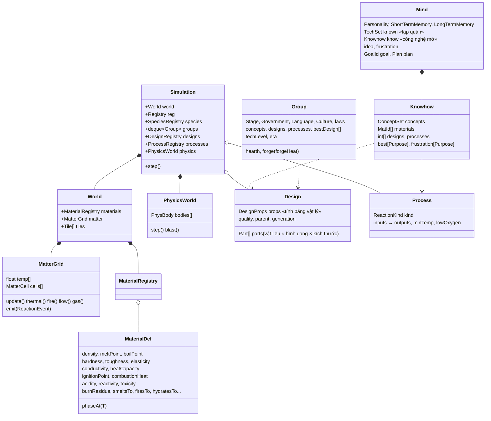

# Kiến trúc WorldBox AI

Tài liệu này giải thích **thiết kế tổng thể**, **lựa chọn công nghệ** và **từng hệ thống** của game:
thế giới, **vật lý & hoá học**, ECS, AI cá nhân (Utility + GOAP + trí nhớ + sáng tạo), **công nghệ mở không
có tech tree**, tiến hoá sinh học & văn hoá, hình thành bộ tộc → làng → quốc gia, cách build cho PC và Android (APK).

Mục lục: [1. Công nghệ](#1-lựa-chọn-công-nghệ) · [2. Sơ đồ hệ thống](#2-sơ-đồ-hệ-thống) ·
[3. Sơ đồ lớp](#3-sơ-đồ-lớp-rút-gọn) · [4. Vật lý & hoá học](#4-hệ-thống-vật-lý--hoá-học) ·
[5. ECS](#5-ecs-entity-component-system) · [6. AI cá nhân](#6-ai-cá-nhân-individual-agent-ai) ·
[7. Công nghệ mở](#7-công-nghệ-mở--tiến-hoá-vô-hạn) · [8. Tiến hoá sinh học](#8-tiến-hoá-sinh-học--văn-hoá) ·
[9. Văn minh](#9-nền-văn-minh-bầy--bộ-lạc--làng--thị-trấn--thành-phố--quốc-gia) ·
[10. Ví dụ](#10-ví-dụ-cụ-thể) · [11. Debug trực quan](#11-debug-trực-quan) · [12. Hiệu năng](#12-hiệu-năng) ·
[13. Build](#13-build) · [14. Mở rộng](#14-mở-rộng)

---

## 1. Lựa chọn công nghệ

| Hạng mục | Lựa chọn | Lý do |
|---|---|---|
| Ngôn ngữ | **C++17** | Hàng nghìn agent AI + mô phỏng nhiệt/chất lỏng/khí/phản ứng mỗi tick → cần hiệu năng gốc. |
| Đồ hoạ / input | **raylib 5.5** | Một API cho Windows/Linux/macOS **và Android** (OpenGL ES 2), cảm ứng đa điểm, nạp font TTF. |
| Build | **CMake** (+ FetchContent tải raylib) | Cùng một `CMakeLists.txt` dùng cho PC và cho Gradle/NDK. |
| Android | **Gradle + NDK + NativeActivity** | Không có dòng Java nào: `libmain.so` được nạp trực tiếp, raylib cung cấp `android_main()`. |
| Đa luồng | `std::thread` (thread pool tự viết) | Không phụ thuộc thư viện ngoài; chạy tốt trên Android. |
| Kiểm thử | Trình chạy **headless** + `ctest` | Lõi mô phỏng không phụ thuộc đồ hoạ → CI, cân bằng game, kiểm thử hoá học. |

Vì sao không SDL2? SDL2 cũng tốt, nhưng raylib gói sẵn cửa sổ, font, texture, camera 2D, gesture và Android
glue — ít mã nền tảng hơn nhiều. Lõi mô phỏng (`wb_core`) hoàn toàn độc lập; đổi sang SDL2 chỉ cần viết lại `src/app/`.

---

## 2. Sơ đồ hệ thống



Thứ tự một **tick** (`Simulation::step`, 1 tick = 0.05 s vật lý):

1. `World::update` — mùa, mưa (theo độ ẩm khí quyển), cây mọc, sét, **MatterGrid::update** (nhiệt, lửa, chất lỏng, khí, phản ứng, chuyển pha địa hình).
2. `rebuildGrid` — dựng lại lưới không gian.
3. **THINK song song** — agent đến lượt: quan sát (kể cả phản ứng hoá học & sự kiện vật lý trong tầm nhìn), Utility, GOAP.
4. **ACT tuần tự** — học từ quan sát, nhặt vật chất, thực thi hành động (đi, săn, bắn, chế tạo, sáng tạo, thí nghiệm ở lò…).
5. `PhysicsWorld::step` + xử lý các vụ nổ do hoá học sinh ra (xung lực lên vật thể & sinh vật).
6. `metabolism` — đói, mệt, **nhiệt độ thật (°C)**, bỏng, khí độc, ngoại lực, mang thai → sinh con.
7. `SocietySystem::update` — nhóm, tri thức tập thể, trình độ công nghệ, thời đại, bếp/lò (nguồn nhiệt thật), ngoại giao, loài mới.
8. `cleanupDead` — để lại xác, máu, **công cụ cũ** (người khác nhặt được có thể "học ngược").

---

## 3. Sơ đồ lớp (rút gọn)



---

## 4. Hệ thống vật lý & hoá học

### 4.1 Vật liệu (`src/phys/Material.h`)
Mọi thứ — gỗ, đá, đá lửa, đá vôi, đất sét, cát, thuỷ tinh, quặng (đồng, thiếc, sắt), kim loại, vàng, than, tro,
sợi, da, xương, thịt, máu, mỡ, muối, lưu huỳnh, diêm tiêu, thuốc súng, axit, kiềm, dầu, CO₂, mê-tan, hiđrô, SO₂…
(**46 vật liệu tự nhiên**) — có thuộc tính số gần thực tế:

| Nhóm | Thuộc tính |
|---|---|
| Vật lý | khối lượng riêng, điểm nóng chảy, điểm sôi, nhiệt dung, độ dẫn nhiệt, độ cứng (Mohs), độ dai, đàn hồi, độ nhớt, dạng bột, xốp |
| Hoá học | điểm bắt lửa, nhiệt cháy, pH, tính hoạt động (oxi hoá), độc tính, dinh dưỡng, chất oxi hoá, chất nổ |
| Biến đổi | cặn & khí khi cháy, nhiệt phân, đông đặc thành, nung thành, khử thành (+nhiệt độ), oxit, hydrat hoá, phân huỷ, muối hoà tan |

* **Trạng thái không lưu cố định** — `phaseAt(T)` suy ra rắn/lỏng/khí từ nhiệt độ hiện tại: nước tự đóng băng/bốc hơi,
  đá nóng chảy thành dung nham, kim loại nung chảy để đúc.
* **Vật liệu mới sinh ra khi đang chạy**: hai kim loại cùng nóng chảy → `MaterialRegistry::alloy()` tạo **hợp kim mới**
  với tính chất pha trộn + *cộng hưởng ngẫu nhiên theo seed thế giới* (có cặp cứng vượt trội, có cặp tệ hơn cả hai).
  Hợp kim của hợp kim cũng được → **danh sách vật liệu không có giới hạn trên**.
* Mỗi thế giới còn có **2 khoáng chất lạ** sinh ngẫu nhiên (tên, độ cứng, điểm chảy… khác nhau mỗi seed).

### 4.2 Lưới vật chất (`src/phys/MatterGrid.cpp`)
Mỗi ô bản đồ có **nhiệt độ (°C)**, tối đa **3 ngăn vật chất rời/lỏng** và **1 ngăn khí**, cộng nguồn nhiệt (bếp/lò).

| Hiện tượng | Mô hình |
|---|---|
| Truyền nhiệt | Khuếch tán theo độ dẫn nhiệt của nền + kéo về khí hậu (mùa, vĩ độ, độ cao, mưa, hiệu ứng nhà kính). Hồ nước có nhiệt dung lớn → điều hoà khí hậu. |
| Trọng lực (top-down) | Chất lỏng **chảy xuống ô thấp hơn** theo độ cao địa hình, nhanh/chậm theo độ nhớt (nước vs dung nham); bột trượt khi dốc vượt góc nghỉ; tường chặn dòng chảy. |
| Khí & áp suất | Khí khuếch tán theo chênh lệch, trôi theo gió, thoát dần vào khí quyển. Áp suất = lượng × (T+273)/293 (khí lý tưởng). |
| Lửa | Cháy là **phản ứng thật**: cần nhiên liệu (cây gỗ, cỏ, nhà gỗ) + oxi + nhiệt ≥ điểm bắt lửa. Toả nhiệt & bức xạ (theo gió, giảm khi ẩm) → lan tự nhiên. Nước/mưa dập lửa. Cháy dày đặc thiếu oxi → **than củi** (nhiệt phân). |
| Chuyển pha địa hình | Hồ < -3°C → **băng** (đi được!); tuyết tan > 6°C thành nước chảy; dung nham nguội → **bazan**; cát > 1700°C (sét đánh!) → **thuỷ tinh**; đất > 1250°C (thiên thạch) → dung nham. |
| Chu trình vật chất | **Nước**: bốc hơi ↔ độ ẩm khí quyển ↔ mưa. **Carbon**: cháy/nung thải CO₂ ↔ cây hấp thụ, đại dương hấp thụ. **Dinh dưỡng**: xác phân huỷ → đất mùn màu mỡ + mê-tan. |

Chỉ các ô **hoạt động** (có vật chất, khí, lò, nhiệt độ lệch nhiều) mới được tính hoá học; ô ổn định "ngủ" và được
đánh thức định kỳ cho phản ứng chậm (gỉ sét, phân huỷ, bay hơi).

### 4.3 Hoá học (`src/phys/Chemistry.cpp`) — 13 quy luật tổng quát
Không liệt kê từng công thức; mỗi quy luật dựa trên **thuộc tính** nên áp dụng được cho cả vật liệu sinh ra lúc chạy:

| # | Quy luật | Ví dụ thực tế trong game |
|---|---|---|
| 1 | Chuyển pha (nóng chảy, đông đặc, sôi, ngưng tụ) | nước ↔ băng ↔ hơi; cát nóng chảy nguội → thuỷ tinh |
| 2 | Cháy / nhiệt phân / nổ | Gỗ + O₂ → Tro + CO₂; Gỗ (thiếu oxi) → Than; mê-tan, hiđrô gặp lửa → nổ |
| 3 | Nung (firing/calcination) | Đất sét 850°C → Gạch; Đá vôi → Vôi sống + CO₂ |
| 4 | Khử quặng (luyện kim) | Quặng đồng + Than ≥1000°C → Đồng + CO₂; quặng sắt cần ≥1250°C |
| 5 | Hợp kim | Đồng lỏng + Thiếc lỏng → **vật liệu mới** |
| 6 | Hydrat hoá | Vôi sống + Nước → Vôi tôi **+320°C** (đủ làm cháy gỗ!); Tro + Nước → Kiềm; SO₂ + nước → Axit (mưa axit) |
| 7 | Axit – bazơ | Axit + Kiềm → Nước muối + nhiệt |
| 8 | Axit – kim loại / đá vôi | Axit + Sắt → Muối + **Hiđrô** (cháy nổ được); Axit + Đá vôi → CO₂ sủi bọt |
| 9 | Oxi hoá chậm | Sắt + ẩm → Gỉ sắt |
| 10 | Tôi nguội | Dung nham + Nước → **Đá vỏ chai** + Hơi nước |
| 11 | Trộn hỗn hợp | Than + Lưu huỳnh + Diêm tiêu → **Thuốc súng** |
| 12 | Phân huỷ | Thịt/sợi → Đất mùn + Mê-tan (đất màu mỡ hơn) |
| 13 | Bay hơi / kết tủa | Nước muối cạn → **Muối kết tủa** |

Mỗi phản ứng phát ra một `ReactionEvent` (vị trí, chất tham gia, sản phẩm, nhiệt độ, thiếu oxi?) → dùng cho **debug**
và để **sinh vật quan sát mà học** (xem §7). `worldbox_sim --chemtest` kiểm tra 9 phản ứng tiêu biểu một cách xác định.

### 4.4 Vật lý vật thể (`src/phys/Physics.cpp`) — 2.5D
* Vật thể có vị trí (x, y) + **độ cao z**, vận tốc, khối lượng, vật liệu, nhiệt độ.
* **Trọng lực** g = 9.8 m/s² theo z, **lực cản** ∝ v²·diện tích/khối lượng, **gió** đẩy vật nhẹ.
* **Va chạm**: mặt đất (nảy theo độ đàn hồi vật liệu, ma sát, lăn xuống dốc), công trình (phá huỷ theo **động năng**
  so với độ cứng tường), sinh vật (sát thương = ½mv² × độ sắc + bị đẩy lùi), vật–vật (bảo toàn động lượng).
* **Archimedes**: vật rơi xuống nước nổi nếu khối lượng riêng < 1000 kg/m³, ngược lại chìm.
* **Nổ**: xung lực hướng tâm ∝ E/(r²+1) lên vật thể và sinh vật; nhà sập, **mảnh vỡ văng ra là vật thể vật lý thật**.
* Sinh vật **dùng định luật vật lý**: cung/ná/máy bắn đá phóng vật thể với vận tốc tính từ năng lượng đàn hồi; cá thể
  tự giải phương trình đạn đạo **θ = ½·asin(g·d / v²)** để ngắm (`ballisticAngle`), sai số theo tay nghề.

---

## 5. ECS (Entity Component System)

`src/core/Ecs.h` — kiểu **sparse set** (~150 dòng): `Entity` 32 bit (version|index), mỗi component một `Pool<T>`
(mảng dày liền kề + mảng thưa), thêm/xoá O(1). Component dữ liệu thuần: `Transform` (vị trí, ngoại lực đẩy),
`Body`, `Inventory` (gỗ/đá/thức ăn + **vật liệu bất kỳ** + **vật phẩm theo thiết kế** kèm độ mòn), `Social`, `GenomeC`, `Mind`.

> ⚠️ Không giữ tham chiếu tới component qua lời gọi có thể thêm component (mảng dày cấp phát lại) — lỗi này đã được
> AddressSanitizer phát hiện và sửa.

---

## 6. AI cá nhân (Individual Agent AI)

```
 QUAN SÁT ──► SUY NGHĨ ──► QUYẾT ĐỊNH ──► HÀNH ĐỘNG ──► HỌC ──► TIẾN HOÁ (vô hạn)
 sinh vật,    Utility AI    GOAP A*        di chuyển,     kỹ năng,      gen (13), văn hoá,
 tài nguyên,  17+ mục tiêu  37 hành động   săn, bắn,      khái niệm,    thiết kế & quy trình
 lửa, nhiệt,  × tính cách   (trạng thái    chế tạo,       vật liệu,     truyền cho thế hệ sau,
 PHẢN ỨNG,    × bức xúc     64 bit)        sáng tạo,      quy trình,    cải tiến không trần
 VẬT LÝ                                    thí nghiệm     thiết kế
```

* **Quan sát**: phân loại sinh vật xung quanh (đồng minh, kẻ lạ, kẻ thù, thú săn mồi, con mồi), quét tài nguyên
  (thức ăn, gỗ, đá — đúng loại đá, quặng — đúng loại quặng), lửa (lửa gần = mối nguy → bỏ chạy về phía mát hơn),
  xác, công cụ cũ, **phản ứng hoá học và sự kiện vật lý trong tầm nhìn**.
* **Trí nhớ**: ngắn hạn (blackboard) + dài hạn (đồ thị sự kiện có độ tin cậy, quên dần, bị phủ nhận) + thống kê thành
  công/thất bại từng hành động (học tăng cường → chi phí GOAP).
* **Utility**: Ăn, Nghỉ, Chạy trốn, Tự vệ, Sinh sản, Giao tiếp, Khám phá, Lao động, **Chế tạo, Sáng tạo, Thí nghiệm,
  Sản xuất**, Xây dựng, Trồng trọt, Giữ lãnh thổ, Thờ cúng, Chiến tranh, Giành quyền lực.
* **GOAP**: 37 hành động (pre/effect/cost); ví dụ `Lùng sục con mồi → Săn mồi → Ăn` hay
  `Đào quặng → Nộp quặng vào kho`, `Sáng tạo thiết kế mới` (bên trong tự đi kiếm vật liệu).
* **Phản xạ**: bị bỏng → nghĩ lại ngay lập tức; né ô quá nóng; khi bị lửa vây thì chỉ đi về phía mát hơn.

---

## 7. Công nghệ MỞ & tiến hoá vô hạn

> **Không có tech tree.** `Knowledge.h` chỉ còn **tập quán xã hội** (săn bầy, thứ bậc, ngôn ngữ, tôn giáo, chữ viết,
> luật…). Toàn bộ công nghệ vật chất là hệ thống mở trong `src/ai/Invention.*` và `Creativity.cpp`.

### 7.1 Bốn lớp tri thức (mỗi cá thể một bản riêng — `Knowhow`)
1. **Vật liệu đã biết** — đã cầm, đào, nhặt, săn được, hoặc thấy sinh ra trong phản ứng.
2. **Khái niệm vật lý** (13): sắc bén, đòn bẩy, sức nổi, đàn hồi, vật chứa, sự cháy, cách nhiệt, nóng chảy, khử quặng,
   hợp kim, chuyển động quay, áp suất, ma sát. Học bằng **trải nghiệm & quan sát thật**, theo **bất kỳ thứ tự nào**:
   khúc gỗ lăn xuống sông và nổi → *sức nổi*; tảng đá lăn xuống dốc → *chuyển động quay*; đá vỡ cứa tay → *sắc bén*;
   thấy vụ nổ/sôi → *áp suất*; xếp đá quanh bếp → *cách nhiệt*; thấy luyện quặng → *khử quặng*…
   Khái niệm quyết định cá thể **hình dung ra** được hình dạng nào (không hiểu đàn hồi thì không nghĩ ra cánh cung).
3. **Thiết kế** — tổ hợp ≤ 6 bộ phận *(vật liệu × hình dạng × kích thước)*, 14 hình dạng: cục, mảnh sắc, cán, mũi nhọn,
   lưỡi, đầu nặng, dây, tấm, vật chứa, ván, bánh xe, thân đàn hồi, ống, tường.
4. **Quy trình hoá học** — (đầu vào, nhiệt độ, thiếu oxi?) → sản phẩm, tạo ra từ một `ReactionEvent` **thật đã quan sát**.

### 7.2 Hiệu năng thiết kế = công thức vật lý (`evaluateDesign`)
| Mục đích | Mô hình |
|---|---|
| Cắt | độ cứng lưỡi × (0.35 + độ dai) × **đòn bẩy** (cán dài, cán giòn thì vô dụng) |
| Đào | độ cứng mũi × đòn bẩy × (1 + khối lượng đầu) |
| Đâm | độ cứng mũi × (1 + chiều dài cán) |
| Đập | √(khối lượng đầu) × √(độ cứng) × đòn bẩy |
| Bắn xa | năng lượng đàn hồi E = đàn_hồi × kích thước × 70 J → **v = √(2E/m)** của mũi tên |
| Công thành | thân đàn hồi lớn hoặc **đòn bẩy đối trọng** (trebuchet) ném đạn 10 kg → động năng (kJ) |
| Chuyên chở | dung tích vật chứa × (1 + 1.5·số bánh xe) — ma sát lăn ≪ ma sát trượt |
| Nổi | **Archimedes**: lượng nước chiếm chỗ − khối lượng bản thân (thuyền độc mộc, bè, thuyền da) |
| Nhiệt độ lò | 600 + 900·(1 − độ dẫn nhiệt của tường), **không vượt điểm chảy của tường**; ống bễ (+400) |
| Tạo lửa | ma sát: khoan gỗ ~300°C, khoan cung ×1.7; hoặc đá lửa đập thép → tia lửa 800°C |
| Giữ ấm | Σ (1 − độ dẫn nhiệt) × kích thước tấm che |

**Ràng buộc chế tạo** (`canFabricate`) cũng là vật lý: đá giòn & cứng thì ghè được; gỗ/xương cần công cụ cắt đủ sắc;
kim loại phải **đúc** (lò ≥ điểm nóng chảy) hoặc **rèn** (lò ≥ 60% + búa đủ nặng); ván/bánh xe cần lưỡi cắt tốt…
Vì vậy tiến bộ tự **xâu chuỗi**: công cụ tốt → gia công được vật liệu khó → lò nóng hơn → kim loại mới → công cụ tốt hơn.

### 7.3 Thuật toán sáng tạo (`conceiveIdea` → kiếm vật liệu → `realizeIdea`)
1. Nhu cầu chưa thoả tích tụ thành **bức xúc** theo mục đích (chặt chậm, quặng quá cứng, bị nước chặn, lạnh, đánh thua…).
2. Chọn mục đích (ngẫu nhiên có trọng số theo bức xúc²) → sinh N = 4 + 14·trí_tuệ phương án: **đột biến** thiết kế tốt nhất,
   **loại suy** từ thiết kế khác, hoặc ghép mới — chỉ dùng hình dạng nghĩ ra được và vật liệu đã biết.
3. **Mô hình tinh thần**: ước lượng = vật lý thật × sai số (giảm khi thông minh hơn) − phạt độ phức tạp → chọn ý tưởng.
4. **Tự đi kiếm** vật liệu còn thiếu (đúng loại đá/quặng, chặt gỗ…), rồi làm **nguyên mẫu** (tiêu tốn vật liệu thật).
5. **Thử nghiệm**: hiệu năng thật. Tốt hơn → thiết kế mới (tên theo ngôn ngữ nhóm, ví dụ *"Rìu Krănkgă"*), lưu phả hệ
   (`parent`, `generation`), **chất lượng tay nghề** tăng mỗi thế hệ cải tiến (không có trần). Thất bại → học khái niệm
   liên quan (bè đá chìm → hiểu *sức nổi*).
6. Ngoài ra: **thí nghiệm ở lò** — bỏ ngẫu nhiên 2–3 vật liệu đang có vào bếp/lò (MatterGrid thật) xem điều gì xảy ra;
   phản ứng sinh ra được quan sát → **quy trình mới**, **vật liệu mới** (kể cả hợp kim chưa từng tồn tại).
7. **Sản xuất**: chạy quy trình đã biết ở lò của nhóm (nạp nguyên liệu thật, chờ phản ứng, thu sản phẩm vào kho).

### 7.4 Vì sao "vô hạn" và "khó dự đoán"
* Vật liệu tăng không giới hạn (hợp kim của hợp kim, khoáng chất lạ theo seed); chất lượng tay nghề tăng mãi;
  **trình độ công nghệ** của nhóm là số thực liên tục (tổng log hiệu năng + độ rộng tri thức), không có mức tối đa.
* **Thời đại** được đặt tên theo vật liệu tiên tiến nhất đang dùng (*Thời đại Đá → Đồng → "Hợp kim Đồng–Thiếc" →
  một hợp kim do chính nhóm đó tạo ra*) — không có danh sách thời đại định sẵn.
* Con đường phụ thuộc môi trường (có núi lửa? có quặng gì? có sông để thấy gỗ nổi?), tính cách, may rủi của
  thí nghiệm, và lịch sử truyền dạy — xem ví dụ §10.3.

---

## 8. Tiến hoá sinh học & văn hoá

* **13 gen**: trí tuệ, sức mạnh, tốc độ, bầy đàn, hung hăng, tò mò, sinh sản, tuổi thọ, chịu lạnh, chịu nóng,
  **khéo tay**, **kích thước**, **bơi lội** — lai ghép + đột biến; chọn lọc tự nhiên không cần hàm fitness.
  Khéo tay quyết định chi trước cầm nắm (mở ra chế tạo), kích thước ảnh hưởng máu/sức/lượng ăn, bơi giỏi thì qua được nước nông.
* **Trí tuệ hiệu dụng** = gen × độ trưởng thành + kinh nghiệm + văn hoá nhóm ("bánh cóc văn hoá").
* **Di truyền văn hoá**: con thừa hưởng tập quán, khái niệm, vật liệu, thiết kế, quy trình của cha mẹ (một phần);
  dạy học qua giao tiếp (ngôn ngữ giúp nhiều); lan truyền giữa láng giềng; **chữ viết** lưu tri thức ở cấp nhóm,
  không có chữ viết thì thiết kế có thể **thất truyền**; nhặt công cụ cũ → **học ngược** thiết kế.
* **Loài mới**: nhóm tồn tại ≥ 15 năm, ≥ 6 thế hệ, gen lệch ≥ 0.30 → loài mới; gen khéo tay trung bình vượt ngưỡng →
  **tiến hoá ra chi trước cầm nắm** (sói khéo tay có thể bắt đầu chế tạo!).

---

## 9. Nền văn minh: Bầy → Bộ lạc → Làng → Thị trấn → Thành phố → Quốc gia

| Giai đoạn | Điều kiện (loài có tay khéo) | Điều kiện (thú) |
|---|---|---|
| Bầy / Nhóm du mục | ≥ 3 đồng loại tụ lại | như bên trái |
| Bộ lạc / Bộ tộc | ≥ 6, *Thứ bậc* + (*Ngôn ngữ* hoặc *Đánh dấu lãnh thổ* + *Săn theo bầy*) | như bên trái |
| Làng / Làng hang ổ | ≥ 10, ≥ 3 nhà/hang, định cư ≥ 1 năm | như bên trái |
| Thị trấn / Lãnh địa | ≥ 22, ≥ 7 nhà, *Trồng trọt* | ≥ 18, *Ngôn ngữ* + *Tôn giáo* |
| Thành phố | ≥ 40, ≥ 12 nhà, **trình độ công nghệ ≥ 12** | ≥ 30, *Luật pháp* |
| **Quốc gia** | ≥ 30, *Luật pháp* + *Chữ viết* + Toà thị chính | ≥ 20, *Luật pháp*, từ Làng |

* **Công trình theo năng lực vật lý**, không theo tech: nhà gỗ cần công cụ cắt ≥ 2, nhà đá/tường cần cắt ≥ 4.5 **hoặc gạch
  nung** (một con đường khác!), cầu cần hiểu sức nổi, **lò luyện** cần thiết kế lò ≥ 900°C, **bếp lửa** cần biết tạo lửa.
  Bếp/lò là **nguồn nhiệt thật** trong MatterGrid, đốt củi/than của kho chung (than cho thêm +150°C).
* Văn hoá, luật lệ (10 loại), thể chế (7 loại), vai trò, ngôn ngữ thủ tục, tôn giáo, ngoại giao, chiến tranh, chinh phục
  (kẻ thắng lấy vật liệu, thiết kế của kẻ thua), tách nhóm — như trước.

---

## 10. Ví dụ cụ thể

### 10.1 Đàn sói → Bộ tộc sói có lãnh thổ & luật lệ (`--scenario wolves`)
Săn chung → *Săn theo bầy* → được dạy lại cho cả bầy → sói thông minh ăn no, sinh nhiều → trí tuệ quần thể tăng →
*Thứ bậc* → *Đánh dấu lãnh thổ* → **Bộ tộc sói** (lãnh thổ có viền, luật *Đầu đàn ăn trước*, *Chia sẻ con mồi*,
*Bảo vệ lãnh thổ*) → hang ổ → tôn giáo → loài sói mới.
**Kết quả chạy thật** (`worldbox_sim --scenario wolves --years 40 --seed 3`):

| Năm | Sự kiện (trích biên niên sử) |
|----|----|
| 0 | Thêrthêski phát minh *Thứ bậc xã hội*; Thi phát minh *Đánh dấu lãnh thổ* |
| 3 | Krusuis phát minh *Nơi trú ẩn* (hang ổ) |
| 9 | Kă (bầy Kruku) phát minh *Săn theo bầy* — lan dần sang các bầy khác qua dạy/bắt chước |
| 11 | **Huhal trở thành Bộ tộc sói** — thể chế *Đầu đàn cai trị*, luật *Bảo vệ lãnh thổ*; cùng năm thành **Làng hang ổ** (12 cá thể) |
| 12–19 | Kraiskôs, Fohăis lần lượt thành bộ tộc → làng hang ổ |
| 25 | Huhal **suy tàn** (thiếu mồi, mất thành viên) — văn minh có thể đi lùi |
| 29 | Sa (bầy Krănô) phát minh *Ngôn ngữ*; Aeaaeă phát minh *Tôn giáo* — sói có tín ngưỡng |
| 40 | 493 sói, 69 nhóm; bầy giỏi nhất trí tuệ TB 0.54 (bầy đầu tiên ~0.10) |

Loài sói mới (chi trước cầm nắm) chỉ xuất hiện khi một nhánh **bị cách ly đủ lâu** (≥ 6 thế hệ, không có
nhóm cùng loài trong bán kính 35 ô) — thường sau 60–100 năm hoặc khi người chơi dùng quyền năng chia cắt bản đồ.

### 10.2 Người nguyên thuỷ (`--scenario humans`)
Nhóm 14 người trắng tay; không có tech tree — mọi công cụ/quy trình dưới đây do chính họ nghĩ ra hoặc **quan sát
từ phản ứng hoá học thật** trong lò. **Kết quả chạy thật** (`worldbox_sim --scenario humans --years 120 --seed 8`):

| Năm | Sự kiện (trích biên niên sử) |
|----|----|
| 1–2 | Cuốc đá (Đào 1.7), giáo mũi đá (Đâm 1.5) — *lần đầu trên thế giới* |
| 8 | Ritai thành **Làng** (12 dân) |
| 15 | Elele chế **mồi lửa** Gỗ (cán) + Đá (cục) → Tạo lửa 249 (đánh lửa bằng ma sát) |
| 25 | Liyeli thấy gỗ âm ỉ thiếu oxi → hiểu quy trình **Nhiệt phân: Gỗ → Than củi** |
| 28–32 | Liyeli thiết kế **lò tường đá** (1025°C) → Ritai dựng lò luyện đầu tiên |
| 33 | Eli quan sát **nung vôi**: Đá vôi → Vôi sống |
| 39 | Kraiylifai (Elikri) hiểu **luyện đồng**: Than củi + Quặng đồng → Đồng |
| 43 | Hiele → Thị trấn → **QUỐC GIA "Thánh quốc Hetaim"** (thần quyền, ngôn ngữ Yaikri) |
| 45 | Lidre lập **"Thánh quốc Rikri"**; năm 47 Rikri dựng lò 1164°C |
| 48 | Thaithri thành **Thành phố** (57 dân) |
| 64 | Laiyai thấy dung nham gặp nước → hiểu **tôi nguội: Bazan → Đá vỏ chai** |
| 73 | Drili (Rikri) hiểu **luyện thiếc**: Than củi + Quặng thiếc → Thiếc |
| 120 | 1742 người, 41 nhóm, 2 quốc gia; 368 thiết kế, 8 quy trình; 1492 thí nghiệm, 1305 mẻ sản xuất trong lò |

Dân số theo thời gian: 136 (năm 20) → 316 (40) → 643 (60) → 1139 (80) → 1534 (100) → 1742 (120).
Trình độ công nghệ các nhóm: 86–114 (không có trần). Đồng/thiếc đã hiểu được nhưng chưa đủ nhiều để thay đá làm
công cụ chính nên tên thời đại vẫn là "Đá" — đúng như lịch sử thật: biết luyện kim ≠ bước vào thời đại kim loại
(xem 10.3: thiếu gỗ làm than là nút thắt).

### 10.3 Phát triển KHÓ DỰ ĐOÁN: "Hai bộ tộc song sinh" (`--scenario twins`)
Hai nhóm người **nhân bản y hệt** (cùng 12 bộ gen, cùng tri thức ban đầu) được thả cùng lúc: (A) cạnh **hồ dung nham
núi lửa** — nhiều bazan, đá vỏ chai, lưu huỳnh, hơi nóng; (B) **rừng lạnh ven sông** — gỗ, đất sét, băng, mùa đông khắc nghiệt.
Không có dòng code nào nói nhóm nào phải phát triển cái gì.
**Kết quả chạy thật** (`worldbox_sim --scenario twins --years 120 --seed 21`; A thả tại (72,136), B tại (103,62)).
Dòng dõi được truy theo `parentGroup` (nhóm tách ra vẫn biết tổ tiên):

| | **Dòng A — bờ núi lửa** (nhóm gốc #0) | **Dòng B — rừng lạnh ven sông** (nhóm gốc #1) |
|---|---|---|
| Vật liệu đầu tiên làm "thời đại" | Đá (năm 10) | **Sợi thực vật** (năm 18, Elambesh) — dây, túi, ná |
| Lò luyện đầu tiên | **năm 21** (1102°C) | năm 48 (Heha, sau khi di cư xuống vùng ấm 36°C) |
| Quy trình hoá học | Nung vôi (21), **luyện đồng (24)**, nhiệt phân, tro–nước | Chỉ nhiệt phân & nước tro trong 50 năm đầu |
| Thiết kế đặc trưng | Chuỳ đầu **quặng đồng**, lò tường đá, cuốc mũi đá cán gỗ | **Thuyền** Gỗ (ván) + Xương (64.3), **cung 5 bộ phận** (16.0), xe bánh diêm tiêu |
| Xã hội | Druxkra → Thị trấn → **Quốc gia "Thánh quốc Kruxkrank"** (năm 59) | Đông dân hơn (Bôthmô 105, Elambesh 66) nhưng chỉ Làng/Bộ lạc |
| Kho (năm 120) | Đá vôi 1298, **quặng đồng 939**, đá vỏ chai, lưu huỳnh, 2 khoáng chất lạ (Thalur, Midra) — **gỗ 0** | Gỗ 126–238, đất sét, sợi — gần như **không có quặng** |
| Trình độ công nghệ | 73–100 | 47–96 |

Không có dòng code nào nói "người núi lửa phải luyện kim" hay "người rừng phải đóng thuyền". Khác biệt sinh ra
từ chuỗi nhân–quả vật lý:

1. **A** sống giữa đá vôi, bazan, quặng → công cụ đá tốt sớm → trải nghiệm nhiệt quanh dung nham & bếp lửa → hiểu khái niệm
   *Nóng chảy/Cách nhiệt* → thiết kế lò tường đá vượt 900°C → mẻ thí nghiệm đầu tiên đổ quặng + than vào lò →
   **tận mắt thấy đồng chảy ra** → học quy trình luyện đồng.
2. Nhưng quanh núi lửa **không có cây**: kho gỗ của A luôn về 0, lò chỉ đốt được khi có người kiếm củi, than củi
   (chất khử) khan hiếm → quặng đồng chất đống 939 đơn vị mà đồng thành phẩm rất ít → A **biết luyện kim nhưng
   bị kẹt ở thời đại Đá** — một "nút thắt sinh thái" không ai lập trình.
3. **B** có gỗ, sợi, sông nước → nhu cầu "Nổi trên nước" và "Bắn xa" bị bức xúc nhiều nhất → sáng tạo thuyền, cung
   phức hợp; khi một nhánh (Heha) di cư tới vùng có quặng thì lập tức xây lò (năm 48) và nhận về vôi sống & đồng.
4. Mô phỏng tất định (cùng seed → cùng lịch sử, bất kể số luồng), nhưng chỉ một thay đổi nhỏ về luật chơi hay seed là
   lịch sử rẽ hướng khác hẳn. Trong các lần chạy thử khi cân bằng game, có lần A
   bước vào **Thời đại Đồng** năm 72 rồi tụt lại Thời đại Đá năm 87 khi cạn gỗ; có lần một nhánh B lập quốc gia
   riêng (Thánh quốc Groyou, 218 dân) nhờ kho gỗ 3990 đơn vị nhưng không có một quy trình hoá học nào.

---

## 11. Debug trực quan

* **Bong bóng suy nghĩ** trên đầu sinh vật (F1 / nút *Suy nghĩ*) + thanh trí tuệ.
* **Bảng sinh vật**: nhu cầu, trí tuệ & giai đoạn nhận thức, mục tiêu + kế hoạch GOAP, điểm Utility, tập quán,
  **khái niệm đã hiểu**, **thiết kế tốt nhất đang mang/đã biết**, **ý tưởng đang theo đuổi**, kỹ năng, trí nhớ.
* **Bảng nền văn minh**: giai đoạn, thể chế, **thời đại & trình độ công nghệ**, thiết kế tốt nhất, lò luyện (°C),
  văn hoá, luật, ngoại giao.
* **Lớp hiển thị** (nút *Lớp*): Thường · **Nhiệt độ** (xanh → đỏ → trắng) · **Khí & áp suất** (khung đỏ = áp suất cao) ·
  **Phản ứng** (nhãn nổi "Quặng đồng + Than củi → Đồng + CO₂ (1150°C)" tại chỗ đang phản ứng).
* **Bảng Hoá học**: CO₂ khí quyển, độ ẩm, gió, số ô hoạt động/đang cháy/vật thể bay, **vật liệu mới sinh ra**,
  kỷ lục phát minh thế giới, danh sách phản ứng gần đây (chạm để bay camera tới).
* Vật thể vật lý vẽ có **bóng đổ** (độ cao z), mũi tên theo hướng bay, mảnh thiên thạch nóng đỏ.

---

## 12. Hiệu năng

| Kỹ thuật | Ở đâu |
|---|---|
| ECS dữ liệu liền kề, lưới không gian CSR | `core/` |
| Batch + LOD tần suất suy nghĩ (ngoài màn hình, sinh vật bản năng nghĩ thưa hơn) | `Simulation` |
| Pha suy nghĩ **song song** (đọc-only thế giới, ghi-only bộ não riêng) — kết quả **xác định** bất kể số luồng | `ThreadPool` |
| Hoá học chỉ trên **ô hoạt động**; ô ổn định ngủ, đánh thức định kỳ | `MatterGrid` |
| Khuếch tán nhiệt 2 tick/lần; chuyển pha địa hình 30 tick/lần | `MatterGrid` |
| Giới hạn số vật thể vật lý (600) và va chạm vật–vật chỉ giữa vật lớn | `PhysicsWorld` |
| Texture địa hình chỉ vẽ lại ô bẩn | `Renderer` |

Đo (4 lõi, headless, ~2000 agent + lưới vật chất 192²): khoảng **800–900 tick/s**; game cần 20 tick/s ở tốc độ 1x.
Kiểm tra bộ nhớ & luồng: AddressSanitizer, UBSan, ThreadSanitizer sạch.

---

## 13. Build

### PC
```bash
sudo apt install libx11-dev libxrandr-dev libxinerama-dev libxcursor-dev libxi-dev libgl1-mesa-dev  # Linux
cmake -S . -B build -DCMAKE_BUILD_TYPE=Release
cmake --build build -j
./build/worldbox                                           # game
./build/worldbox_sim --scenario twins --years 120 --seed 21  # headless
./build/worldbox_sim --chemtest                            # kiểm thử hoá học
ctest --test-dir build --output-on-failure
```

### Android (APK)
Android SDK 34, NDK r25+, CMake 3.22.1 (SDK), JDK 17, Gradle 8.7+:
```bash
cd android && gradle assembleRelease -PndkVersion=<phiên_bản_NDK>
adb install -r app/build/outputs/apk/release/app-release.apk
```
`NativeActivity` nạp `libmain.so`; Gradle gọi chính `CMakeLists.txt` gốc. CI (`.github/workflows/build.yml`) build APK
mỗi lần push (mục *Artifacts*). APK release ký bằng khoá debug để cài thử; thay keystore khi phát hành.

### Điều khiển
| Thao tác | Cảm ứng | PC |
|---|---|---|
| Di chuyển bản đồ | kéo 1 ngón (Quan sát) / kéo 2 ngón | chuột phải/giữa, WASD |
| Phóng to/thu nhỏ | chụm 2 ngón | lăn chuột |
| Quyền năng / vẽ | chạm, giữ & kéo | chuột trái |
| Xem sinh vật / nền văn minh | chạm vào sinh vật / lãnh thổ | click |
| Tốc độ | ‖ 1x 4x 15x 50x | Space, 1–5 |
| Debug | *Suy nghĩ*, *Lớp*, *Hoá học*, *Biên niên* | F1, Tab |

---

## 14. Mở rộng

* **Vật liệu**: thêm một khối trong `MaterialRegistry::initDefaults` — mọi quy luật hoá học tự áp dụng theo thuộc tính.
* **Quy luật hoá học**: thêm một khối trong `reactCell` (dựa trên thuộc tính, không phải tên chất).
* **Hình dạng bộ phận / mục đích**: thêm vào `Shape`/`Purpose` + công thức trong `evaluateDesign` + ràng buộc `canFabricate`.
* **Khái niệm**: thêm vào `Concept` + nguồn trải nghiệm (`experience(...)`) + hình dạng nó mở khoá (`conceivable`).
* **Hành động AI**: `ActionId` + dòng trong `kActions` + `case` trong `exec` — GOAP tự ghép vào kế hoạch.
* **Loài**: `SpeciesRegistry::initDefaults`.

---

## 15. Hành tinh hình cầu, lòng đất, góc nhìn thứ nhất, phòng thí nghiệm gen

### 15.1 Hành tinh hình cầu (`World::generate`, `WrapSpace`)
* Bản đồ = phép chiếu trụ đẳng chữ nhật của một quả cầu: x = kinh độ (**quấn vòng**), y = vĩ độ (mép trên/dưới là hai cực).
  Chiều rộng = 2 × chiều cao. `World::at`, `MatterGrid::idx`, `SpatialGrid::query`, `dist2/wdiff` đều quấn theo x, nên
  sinh vật, lửa, nước, khí, mũi tên đi qua "đường đổi ngày" liền mạch; `moveTo` chọn đường ngắn nhất quanh hành tinh.
* Địa hình lấy mẫu **nhiễu 3D trên mặt cầu** (không có đường nối), uốn toạ độ bằng nhiễu để bờ biển tự nhiên, dãy núi dùng
  nhiễu "gờ". Kiểu hành tinh quyết định số "mảng lục địa" (khoảng cách góc trên cầu), kích thước, tần số nhiễu và tỉ lệ đất
  liền; mực nước biển đặt theo **phân vị** để luôn đúng tỉ lệ (Siêu lục địa ~33%, Nhiều châu lục ~36%, Quần đảo ~20%,
  Đại dương ~7%, Khô ~80%).
* Quả địa cầu 3D (`Renderer::drawGlobe`): lưới cầu UV tự dựng có (u, v) = (x/W, y/H) → dán thẳng texture pixel art của bản đồ
  (cập nhật trực tiếp), màu đỉnh tính ánh sáng ngày/đêm, quầng khí quyển, sao; chạm mặt cầu → tia cắt cầu → kinh/vĩ độ → hạ xuống.

### 15.2 Lòng đất (`UnderTile`, `World::generateUnderground`, `World::digMine`)
Một tầng ngầm dưới mọi ô: đá, hang (mặt đẳng trị của nhiễu → đường hầm ngoằn ngoèo + hang lớn), hồ ngầm, magma (gần núi lửa),
mạch quặng (theo "tỉnh khoáng sản"), nấm hang (mọc lại). Khai thác đá/quặng trên đồi núi → `digMine` biến đá thành đường hầm và
**đào tiếp về phía mạch quặng gần nhất**, đưa quặng lên cửa hầm (công trình *Hầm mỏ*) → mỏ là nguồn quặng lâu dài.

### 15.3 Môi trường sống & đa dạng loài (`Habitat`, `Simulation::habitable/foodAt`)
Mỗi loài có môi trường sống (Cạn, Nước, Trời, Hang, Lưỡng cư) và hình dáng (`BodyPlan`). Một hàm trung tâm `habitable()`
quyết định di chuyển, sinh sản, thả sinh vật; `foodAt()` chọn thức ăn (cỏ quả / tảo / nấm & côn trùng). Sinh vật ở **tầng
khác** (hang ↔ mặt đất) không thấy nhau; `canHunt` xét cả môi trường (cá mập chỉ săn dưới nước, đại bàng bắt được cá...).
Sức chứa môi trường theo loài (`capShare`) giữ hệ sinh thái cân bằng và chừa chỗ cho các loài có trí khôn.

### 15.4 Góc nhìn thứ nhất (`FirstPerson.cpp`) & nhập vai (`Brain::playerMove/playerAction`)
Lưới địa hình 53×53 ô quanh sinh vật dựng lại khi nó sang ô mới. Đồ hoạ low-poly:
* **Shader riêng** (GLSL 330 trên PC, GLSL 100/120 trên điện thoại & máy cũ; lỗi thì quay về shader mặc định): ánh nắng theo
  pháp tuyến + sương mù theo độ sâu hoà vào màu chân trời; bầu trời gradient, mặt trời, mây trôi vẽ 2D theo hướng nhìn.
* **Địa hình** tô màu theo đỉnh: màu & độ cao tại mỗi góc = trung bình 4 ô kề → chuyển sắc mượt (cỏ → cát → tuyết trên đỉnh).
  Mặt nước là một lưới liền, sóng tính tại góc ô. Cỏ, cây (tán nhiều lớp / lá kim nhiều tầng) đung đưa theo gió.
* **Nội suy**: mô phỏng chạy 20 tick/s, màn hình 60 khung/s → vị trí & hướng hiển thị của mỗi sinh vật (`SmoothState`) đuổi
  theo vị trí mô phỏng với hệ số `1 - e^(-14·dt)`; pha bước chân tăng theo quãng đường thật nên chân không "trượt".
* **Hoạt ảnh khung xương khối**: chi quay quanh khớp hông/vai, thân nhấp nhô, đầu gật, đuôi vẫy, cánh vỗ/lượn, cá quẫy đuôi;
  trạng thái lấy từ AI (ngủ → nằm, ăn → cúi đầu, săn/chiến đấu → lao tới, thu thập/xây → vung tay).
* **Cơ thể của chính mình** vẽ trong hệ toạ độ camera: tay + công cụ (người), mõm + chân trước (thú), mép cánh (chim);
  `actAnim` tạo cú vung khi người chơi hành động.
Ba chế độ: mặt đất, dưới nước (đáy biển), trong hang (khối đá
có vách đứng, ánh sáng tắt dần theo khoảng cách, nấm phát quang). Khi điều khiển, `Mind::possessed` tắt AI của cá thể; hành
động của người chơi đi qua đúng luật của mô phỏng (sát thương, độ cứng vật liệu so với công cụ, môi trường sống...).

### 15.4a Môi trường lạ & hơi thở (`Simulation::endurance/envSpeed/nearestNative`, `Body::breathUsed`)
Môi trường sống (`habitable`) không còn là bức tường: mọi cá thể vào được ô "lạ" mà nó chịu được, chỉ khác nhau ở **số giây chịu
đựng** — thú trên cạn: lội nước nông 300 + 600·bơi lội giây, bơi nước sâu 25 + 150·bơi lội giây (người ~70 s, gấu ~107 s), có
bè/thuyền thì như trên cạn; cá trên cạn 6 s. Ở ngoài môi trường sống thì `breathUsed` tăng theo tỉ lệ đó (về lại thì hồi trong ~3 s);
cạn hơi → mất 0.6% máu tối đa mỗi tick (~8 s là chết ngạt / đuối). Tốc độ nhân `envSpeed` (lội 0.55–0.95, bơi 0.25–0.85, cá quẫy 0.15).
AI: đã ở trong môi trường lạ thì đi tiếp được, hụt quá 35% hơi thì đổi đích về ô quen thuộc gần nhất; còn **tự nguyện** bước vào
thì chỉ loài bơi giỏi (gen > 0.65) — đo trên 12 seed sói / 6 seed người, cho AI tự lội tự do làm bầy tản mát, giảm tỉ lệ lập bộ
tộc (20/22 so với 22/22). Người chơi thì đi đâu cũng được. `breathUsed` (uint16) nằm trong khoảng đệm sẵn có của `Body` nên
`sizeof(Body)` không đổi — tệp lưu cũ vẫn tải được.

### 15.4b Lưu / tải (`SaveLoad.cpp`)
Một lớp `Archive` với hàm `io()` dùng chung cho cả ghi và đọc (không thể lệch thứ tự trường). `SaveAccess` là `friend` của các
lớp có trạng thái riêng (World, MatterGrid, MaterialRegistry, Registry, Simulation...). Phần đầu tệp (`SaveInfo`) đọc riêng để
liệt kê ô lưu; kèm phiên bản định dạng + dấu vân tay bố cục struct → tệp lạ bị từ chối thay vì đọc sai. Ghi ra tệp tạm rồi
đổi tên (không hỏng ô lưu cũ khi mất điện). Kiểm thử `save_load_world`: chạy N năm → lưu → tải → chạy N năm cho kết quả giống
hệt từng con số so với chạy liền 2N năm.

### 15.4c Chế tạo & xây dựng của người chơi (`checkCraft/playerCraft/suggestDesign`, `Brain::playerBuild*`)
Người chơi dùng **cùng** `evaluateDesign` + `canFabricate` + `workshopOf` với AI: ghép tối đa 6 bộ phận, `checkCraft` trả hiệu năng,
vật liệu cần (túi + kho nhóm), bộ phận không gia công được kèm lý do (`fabricateProblem`: kim loại cần lò ≥ điểm chảy để đúc hoặc
≥ 60% + búa để rèn, mảnh ghè ≤ 1.2, cần công cụ cắt ≥ ... ). `suggestDesign` dựng khung bộ phận theo mục đích rồi tối ưu tham lam
vật liệu từng bộ phận. Thiết kế mới được đặt tên theo ngôn ngữ nhóm, vào sổ thiết kế thế giới, ghi biên niên sử nếu là kỷ lục.
Xây dựng: `playerBuildProblem` kiểm tra quy luật vật lý (công cụ cắt — tính cả dụng cụ đang cầm, gạch nung thay đẽo đá, lò ≥ 900°C,
biết tạo lửa, cầu trên mặt nước) rồi `finishBuilding` (dùng chung với AI) cập nhật bếp / lò / cầu của nhóm. Kiểm thử `player_craft_build`.

### 15.4d Thế giới đang sống trên GitHub (`worldbox_sim --live`, `.github/workflows/live-world.yml`, `app/Net.cpp`)
Mỗi giờ GitHub Actions: build `worldbox_sim` (có cache) → tải `world.wbs` + `state.env` từ Release `live-world` → chạy
`(bây giờ − lần trước) × 20 tick/giây × tốc độ` (tối đa 3 giờ/lượt, ngân sách 30 phút) → lưu, viết `summary.md` (bảng nhóm, loài,
30 sự kiện gần nhất) làm ghi chú Release và Job Summary → đăng lại tài sản (+ `backup-<thứ>.wbs` xoay vòng 7 ngày). Lưu ở Release
thay vì commit để lịch sử git không phình. `reseedSapients`: nếu loài có trí khôn còn < 6 cá thể, "thần linh gieo mầm" một bộ lạc
mới để thế giới chạy vô thời hạn vẫn có văn minh. Tệp `.wbs` mới trong `world/upload/` (nhận diện bằng sha256) được dùng làm thế giới
mới một lần. Game tải về bằng `Download` chạy nền: PC gọi `curl` của hệ điều hành, Android dùng `HttpURLConnection` qua JNI (quyền
INTERNET); tải vào tệp tạm rồi đổi tên. Lưu ý: GitHub tạm dừng lịch chạy của repo công khai sau 60 ngày không có hoạt động — bấm
*Enable workflow* trong tab Actions để bật lại.

### 15.5 Phòng thí nghiệm gen (`GeneLab`, `CustomGene`, `addCustomGene`)
Bản nháp loài = bản sao loài gốc; có thể lai 50/50 hoặc lấy từng phần (trí tuệ & tay, hình dáng, môi trường, thức ăn, màu, sức
mạnh, gen tự tạo) từ loài cho gen, chỉnh 13 gen, chỉnh ngoại hình & sinh thái, và **tạo gen mới** gồm tên + hiệu ứng (14 loại) +
cường độ. Hiệu ứng lên bộ gen/môi trường (não bộ, lông dày, mang cá, đôi cánh...) áp dụng một lần khi cấy; hiệu ứng lên cơ thể
(sinh lực, cơ bắp, nọc độc, vảy giáp...) biểu hiện mỗi khi sinh ra cá thể; quang hợp làm đói chậm. Loài mới (`engineered`,
`parent`, `donor`) di truyền gen cho mọi hậu duệ; khi phân hoá loài tự nhiên (`speciation`) còn có 40% khả năng **đột biến ra
gen mới** hợp với môi trường (lạnh → lông dày, ven nước → mang cá, hang → phát quang) → cây sự sống ngày càng đa dạng.
Kiểm thử: `worldbox_sim --genelab-test` (người × đại bàng + cánh + nọc độc → bay được qua biển, sinh sôi 10 → 26 trong 3 năm).

### 15.6 Xoay màn hình Android (`cmake/PatchRaylibAndroid.cmake`)
raylib 5.5 cố định kích thước bộ đệm khung hình lúc khởi động nên khi xoay máy hình bị kéo giãn. Bản vá (áp dụng lúc FetchContent)
theo dõi kích thước thật của cửa sổ, tạo lại EGL surface và cập nhật kích thước/viewport nội bộ; game tự tính lại tỉ lệ giao diện,
tâm camera và bố cục menu (2 cột khi màn hình ngang). Build APK sẽ dừng nếu bản vá chưa được áp dụng.

### 15.7 Sửa lỗi lập kế hoạch GOAP
A* trước đây mở rộng cả các hành động rẻ nhưng vô ích (ăn, bỏ chạy...) nên tràn ngân sách 300 nút trước khi tìm ra chuỗi dài như
"gom vật liệu → xây". Nay có bước **cắt tỉa theo liên quan** (hồi quy từ mục tiêu: chỉ mở rộng hành động có hiệu ứng góp vào mục
tiêu hoặc điều kiện của hành động liên quan) → việc xây nhà không còn thất bại hàng loạt; 6/6 seed người nguyên thuỷ lập làng trong 40 năm.
